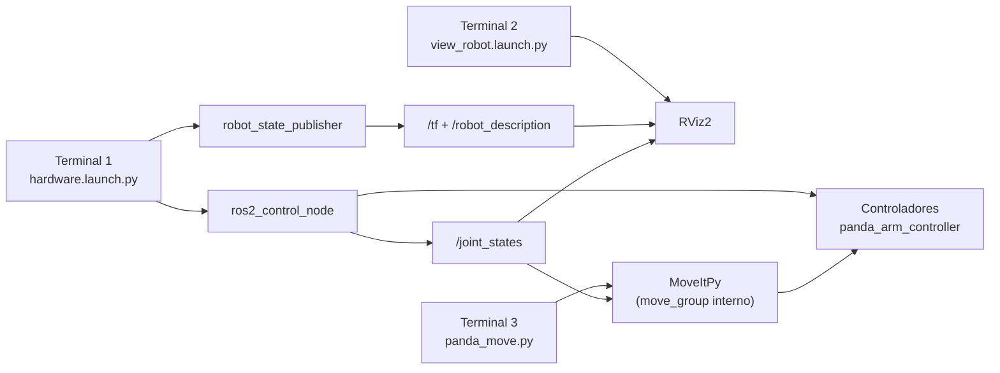
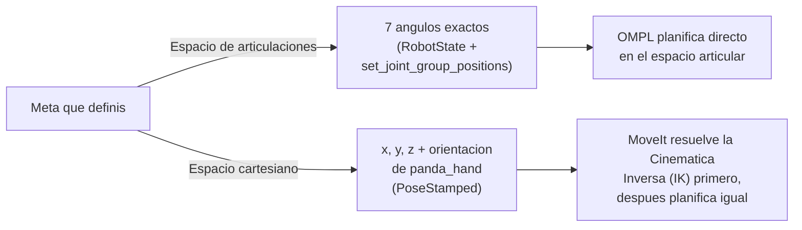
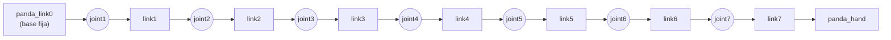
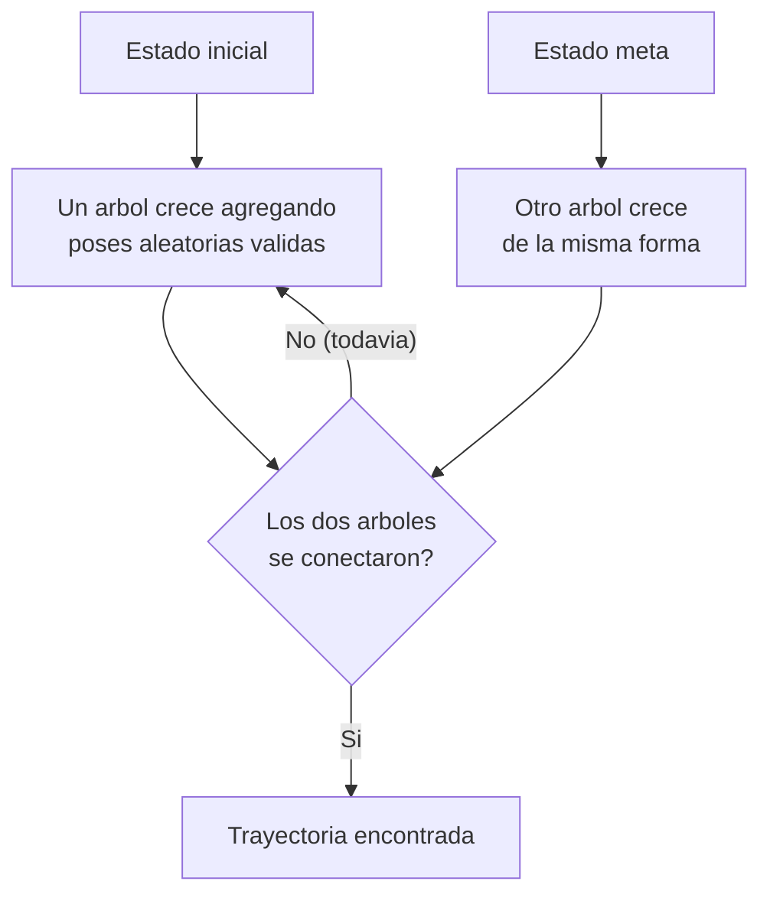
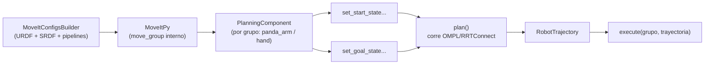
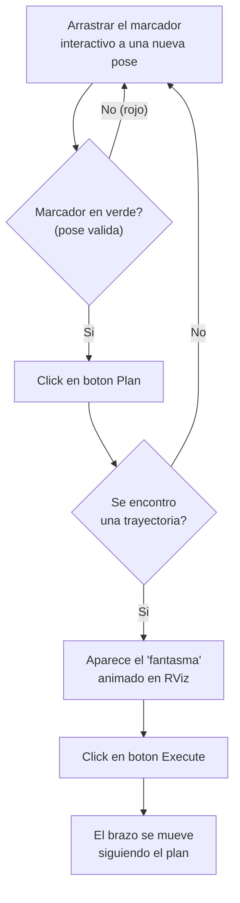

# Tutorial MoveIt2: RViz y Movimiento por Código Python

*Octubre 23, 2026 · @Diego Pedrazas*

Guía completa del setup de MoveIt2 en Ubuntu 22.04 con ROS 2 Humble: desde mover el brazo Panda a mano en RViz hasta programar movimientos con Python, más un manual de operación diaria.

## Arquitectura del sistema

Todo el setup corre en **3 terminales simultáneas**, cada una con un rol fijo. Nunca hace falta correr `move_group` ni RViz del demo original junto con el script de Python: se pisan entre sí.



- **Terminal 1** simula el "hardware" del brazo (sin robot real): publica su posición y activa los controladores.
- **Terminal 2** es solo visualización: muestra en RViz lo que Terminal 1 está publicando.
- **Terminal 3** es el cerebro de planificación: calcula trayectorias y se las manda a los controladores de Terminal 1. Lo que hace se ve reflejado automáticamente en Terminal 2.

## Conceptos fundamentales para programar movimiento de brazos

### 1. Espacio de articulaciones vs. espacio cartesiano

Hay dos formas de decirle a MoveIt2 "a dónde" mover el brazo:



- **Espacio de articulaciones** (lo que usa `panda_move.py`): vos le decís el ángulo exacto de cada una de las 7 articulaciones. Es preciso y predecible, pero requiere que vos (o algo) calcule esos ángulos.
- **Espacio cartesiano** (lo que usa `add_obstacle_topic.py` + `set_goal_state(pose_stamped_msg=...)`): vos le decís dónde en el espacio 3D real querés que termine la mano (`panda_hand`), y MoveIt resuelve la **cinemática inversa (IK)** — el cálculo de qué ángulos de articulaciones logran esa posición — antes de planificar. Es más intuitivo para pensar ("quiero la mano en x=0.4, y=0, z=0.5"), pero puede haber varias soluciones de IK o ninguna, según la pose pedida.

### 2. La cadena cinemática del Panda

El brazo es una cadena de eslabones (*links*) unidos por articulaciones (*joints*) rotacionales, de la base a la pinza:



Cada `panda_jointN` solo puede rotar dentro de su rango mecánico real (ver la tabla de rangos más abajo, en la sección de Python). El efecto de mover una articulación se propaga a todo lo que está "después" de ella en la cadena — por eso `panda_joint1` (la base) mueve todo el brazo entero, mientras que `panda_joint7` (la muñeca) solo rota la mano.

### 3. Cómo planifica OMPL (el algoritmo, en criollo)

El planificador por defecto (RRTConnect) no calcula la ruta óptima matemáticamente — construye dos "árboles" de posiciones alcanzables al azar, uno creciendo desde el inicio y otro desde la meta, hasta que se tocan:



Esto explica varias cosas que ya viste en la práctica:

- Por qué el mismo movimiento puede tardar tiempos distintos cada vez (es aleatorio).
- Por qué un `planning_time` muy corto puede hacer que falle un movimiento que en otro intento sí funciona.
- Por qué una meta literalmente imposible (ej. `panda_joint4 = 0`, o una pose dentro de un objeto de colisión) nunca va a encontrar solución, sin importar cuánto tiempo le des: no hay ningún estado válido cerca de esa meta para que el árbol la alcance.

### 4. La Planning Scene

Es el "modelo del mundo" que usa el planificador para chequear colisiones: incluye la posición actual del robot (vía `/joint_states`) más cualquier objeto agregado (como la mesa que creamos). Cada vez que heurísticamente el planificador prueba una pose candidata, la valida contra esta escena — por eso una meta dentro de un objeto sólido nunca es válida, independientemente de qué tan bien programado esté el resto del script.

### 5. Anatomía de una planificación con MoveItPy

Así se conectan las piezas que fuiste armando en cada script:



Esto es literalmente el esqueleto que se repite en `panda_move.py`, `gripper_move.py` y `add_obstacle.py` — solo cambia el grupo (`panda_arm` vs `hand`) y cómo se define la meta (`RobotState` vs `configuration_name` vs `PoseStamped`).

## Instalación de MoveIt2

MoveIt2 tiene soporte binario oficial para Ubuntu 22.04 + ROS 2 Humble. Pasos ya completados:

**Verificar la distro de ROS 2:**

```bash
echo $ROS_DISTRO
# debe devolver: humble
```

**Instalar MoveIt2 (paquete binario):**

```bash
sudo apt update
sudo apt install -y ros-humble-moveit
```

**Instalar y configurar CycloneDDS** (middleware recomendado por MoveIt para evitar problemas de comunicación):

```bash
sudo apt install -y ros-humble-rmw-cyclonedds-cpp
echo "export RMW_IMPLEMENTATION=rmw_cyclonedds_cpp" >> ~/.bashrc
```

**Clonar el workspace de tutoriales/demo** (trae el robot Panda de ejemplo):

```bash
mkdir -p ~/ws_moveit/src
cd ~/ws_moveit/src
git clone -b humble https://github.com/moveit/moveit2_tutorials
```

**Importar dependencias y compilar:**

```bash
vcs import --recursive < moveit2_tutorials/moveit2_tutorials.repos
sudo rosdep init   # solo la primera vez en la maquina
rosdep update
rosdep install -r --from-paths . --ignore-src --rosdistro humble -y
cd ~/ws_moveit
sudo apt install -y python3-colcon-mixin
colcon mixin add default https://raw.githubusercontent.com/colcon/colcon-mixin-repository/master/index.yaml
colcon mixin update default
colcon build --mixin release --executor sequential
```

La compilación tarda 20-30 minutos. `--executor sequential` evita saturar la CPU/RAM.

**Bug de locale (importante):** si el sistema usa coma como separador decimal, `move_group` falla al leer los límites de las articulaciones (`joint_limits.yaml`) y el robot no aparece en RViz. Solución permanente, ya aplicada:

```bash
echo 'export LC_NUMERIC="en_US.UTF-8"' >> ~/.bashrc
source ~/.bashrc
```

## Planificación manual en RViz (Plan & Execute)

Esta es la forma más simple de mover el brazo: arrastrando un marcador en la pantalla, sin escribir código.

### Levantar el demo completo

```bash
source ~/ws_moveit/install/setup.bash
ros2 launch moveit2_tutorials demo.launch.py rviz_config:=panda_moveit_config_demo.rviz
```

Esto levanta `move_group` + RViz en un solo comando (a diferencia del flujo de Python, donde van separados).

### Flujo de uso



### Pasos detallados

1. En la escena 3D, ubicar el **marcador interactivo** (flechas + anillos de colores) sobre la mano del brazo.
2. Arrastrar una flecha para **trasladar** la posición, o un anillo para **rotar** la orientación.
3. Si el marcador o el brazo se ponen en rojo, esa pose no es alcanzable o está en colisión — mover a otra posición.
4. En el panel izquierdo ("MotionPlanning" → pestaña "Planning"), click en **Plan**.
5. Revisar que aparezca la trayectoria fantasma (animación de brazos translúcidos).
6. Click en **Execute** (o usar "Plan & Execute" para hacer ambos pasos juntos).

> **Tip:** el botón **Plan** está en la esquina superior izquierda del panel "MotionPlanning", columna "Commands".

## Movimiento programático con Python (MoveItPy)

`moveit_py` permite planificar y ejecutar movimientos sin RViz, ideal para integrarlo en un sistema más grande (por ejemplo, un proyecto que reciba órdenes desde otra aplicación).

### Requisito: un launch file solo con el "hardware" simulado

`move_group` no puede correr dos veces a la vez (compiten por los mismos controladores). Por eso se separó el demo original en dos partes: el hardware simulado (`hardware.launch.py`) y el propio script de Python, que trae su `move_group` interno.

`~/moveit_scripts/hardware.launch.py`:

```python
import os
from launch import LaunchDescription
from launch_ros.actions import Node
from ament_index_python.packages import get_package_share_directory
from moveit_configs_utils import MoveItConfigsBuilder

def generate_launch_description():
    moveit_config = (
        MoveItConfigsBuilder("moveit_resources_panda")
        .robot_description(file_path="config/panda.urdf.xacro")
        .trajectory_execution(file_path="config/gripper_moveit_controllers.yaml")
        .to_moveit_configs()
    )

    static_tf = Node(
        package="tf2_ros", executable="static_transform_publisher",
        name="static_transform_publisher", output="log",
        arguments=["0.0", "0.0", "0.0", "0.0", "0.0", "0.0", "world", "panda_link0"],
    )
    robot_state_publisher = Node(
        package="robot_state_publisher", executable="robot_state_publisher",
        name="robot_state_publisher", output="both",
        parameters=[moveit_config.robot_description],
    )
    ros2_controllers_path = os.path.join(
        get_package_share_directory("moveit_resources_panda_moveit_config"),
        "config", "ros2_controllers.yaml",
    )
    ros2_control_node = Node(
        package="controller_manager", executable="ros2_control_node",
        parameters=[moveit_config.robot_description, ros2_controllers_path],
        output="both",
    )
    joint_state_broadcaster_spawner = Node(
        package="controller_manager", executable="spawner",
        arguments=["joint_state_broadcaster", "--controller-manager-timeout", "300",
                   "--controller-manager", "/controller_manager"],
    )
    arm_controller_spawner = Node(
        package="controller_manager", executable="spawner",
        arguments=["panda_arm_controller", "-c", "/controller_manager"],
    )
    hand_controller_spawner = Node(
        package="controller_manager", executable="spawner",
        arguments=["panda_hand_controller", "-c", "/controller_manager"],
    )

    return LaunchDescription([
        static_tf, robot_state_publisher, ros2_control_node,
        joint_state_broadcaster_spawner, arm_controller_spawner, hand_controller_spawner,
    ])
```

### El script de movimiento

`~/moveit_scripts/config/moveit_cpp.yaml` (copiado del tutorial oficial, define el pipeline OMPL):

```yaml
planning_scene_monitor_options:
  name: "planning_scene_monitor"
  robot_description: "robot_description"
  joint_state_topic: "/joint_states"
  attached_collision_object_topic: "/moveit_cpp/planning_scene_monitor"
  publish_planning_scene_topic: "/moveit_cpp/publish_planning_scene"
  monitored_planning_scene_topic: "/moveit_cpp/monitored_planning_scene"
  wait_for_initial_state_timeout: 10.0

planning_pipelines:
  pipeline_names: ["ompl"]
ompl:
  planning_plugin: ompl_interface/OMPLPlanner
  request_adapters: >-
    default_planner_request_adapters/AddTimeOptimalParameterization
    default_planner_request_adapters/FixWorkspaceBounds
    default_planner_request_adapters/FixStartStateBounds
    default_planner_request_adapters/FixStartStateCollision
    default_planner_request_adapters/FixStartStatePathConstraints
  planner_configs:
    PRMstarkConfigDefault:
      type: geometric::PRMstar
  panda_arm:
    planner_configs:
      - PRMstarkConfigDefault

plan_request_params:
  planning_attempts: 1
  planning_pipeline: ompl
  planning_time: 5.0
  max_velocity_scaling_factor: 1.0
  max_acceleration_scaling_factor: 1.0
```

`~/moveit_scripts/panda_move.py` (versión parametrizada: acepta la meta por `--joints`, y si no se pasa nada, alterna automáticamente entre dos poses):

```python
#!/usr/bin/env python3
import argparse
import os
import time
import rclpy
from rclpy.logging import get_logger

from moveit.core.robot_state import RobotState
from moveit.planning import MoveItPy
from moveit_configs_utils import MoveItConfigsBuilder

SCRIPT_DIR = os.path.dirname(os.path.abspath(__file__))

def parse_args():
    parser = argparse.ArgumentParser(
        description="Mueve el brazo Panda a una pose de articulaciones dada."
    )
    parser.add_argument(
        "--joints",
        type=float,
        nargs=7,
        metavar=("J1", "J2", "J3", "J4", "J5", "J6", "J7"),
        default=None,
        help="Los 7 valores de articulaciones en radianes. "
             "Si no se pasa, el brazo alterna automaticamente entre dos poses.",
    )
    return parser.parse_known_args()[0]

def plan_and_execute(robot, planning_component, logger, sleep_time=0.0):
    logger.info("Planificando trayectoria...")
    plan_result = planning_component.plan()

    if plan_result:
        logger.info("Plan encontrado, ejecutando...")
        robot_trajectory = plan_result.trajectory
        robot.execute("panda_arm", robot_trajectory)
    else:
        logger.error("La planificacion fallo")

    time.sleep(sleep_time)

def main():
    args = parse_args()
    rclpy.init()
    logger = get_logger("moveit_py_demo")

    moveit_config = (
        MoveItConfigsBuilder("moveit_resources_panda")
        .robot_description(file_path="config/panda.urdf.xacro")
        .trajectory_execution(file_path="config/gripper_moveit_controllers.yaml")
        .moveit_cpp(
            file_path=os.path.join(SCRIPT_DIR, "config", "moveit_cpp.yaml")
        )
        .to_moveit_configs()
    )

    panda = MoveItPy(node_name="moveit_py_demo", config_dict=moveit_config.to_dict())
    panda_arm = panda.get_planning_component("panda_arm")
    robot_model = panda.get_robot_model()

    logger.info("Instancia de MoveItPy creada correctamente")
    time.sleep(2.0)

    panda_arm.set_start_state_to_current_state()

    if args.joints is not None:
        objetivo = list(args.joints)
        logger.info(f"Usando meta pasada por argumento: {objetivo}")
    else:
        current_state = panda_arm.get_start_state()
        current_joint1 = current_state.get_joint_group_positions("panda_arm")[0]
        nuevo_joint1 = -0.5 if current_joint1 > 0 else 0.5
        objetivo = [nuevo_joint1, -0.785, 0.0, -2.356, 0.0, 1.571, 0.785]
        logger.info(f"Sin --joints, alternando automaticamente: {objetivo}")

    goal_state = RobotState(robot_model)
    goal_state.set_joint_group_positions("panda_arm", objetivo)
    panda_arm.set_goal_state(robot_state=goal_state)

    plan_and_execute(panda, panda_arm, logger, sleep_time=3.0)

    rclpy.shutdown()

if __name__ == "__main__":
    main()
```

### Qué hace cada parte del script

| Bloque | Qué hace |
| --- | --- |
| `MoveItConfigsBuilder(...)` | Carga URDF, SRDF y config del pipeline OMPL para el Panda |
| `MoveItPy(...)` | Levanta un `move_group` interno propio del script |
| `set_start_state_to_current_state()` | El plan parte de donde el brazo esté REALMENTE (no de una pose fija) |
| `RobotState(robot_model)` + `set_joint_group_positions` | Define la meta como valores explícitos de articulaciones |
| `planning_component.plan()` | Corre OMPL (RRTConnect) y devuelve la trayectoria si hay solución |
| `robot.execute("panda_arm", trayectoria)` | Manda la trayectoria al controlador real (simulado) |

### Qué significa cada parámetro (`--joints`)

El Panda tiene 7 articulaciones rotacionales en cadena, cada una llamada `panda_jointN`. Cada valor que le pasás a `--joints` es el ángulo de esa articulación **en radianes**, en orden de la base a la pinza.

| Articulación | Qué mueve | Rango real (radianes) | Rango real (° aprox.) |
| --- | --- | --- | --- |
| panda_joint1 | Rota toda la base (como un giro de cintura) | -2.97 a 2.97 | -170° a 170° |
| panda_joint2 | Inclina el "hombro" hacia adelante/atrás | -1.83 a 1.83 | -105° a 105° |
| panda_joint3 | Rota el brazo superior sobre su propio eje | -2.97 a 2.97 | -170° a 170° |
| panda_joint4 | Dobla el "codo" | -3.14 a 0.09 | -180° a 5° |
| panda_joint5 | Rota el antebrazo sobre su propio eje | -2.97 a 2.97 | -170° a 170° |
| panda_joint6 | Inclina la "muñeca" | -0.09 a 3.82 | -5° a 219° |
| panda_joint7 | Rota la mano/pinza sobre su propio eje | -2.97 a 2.97 | -170° a 170° |

**Notas importantes:**

- `panda_joint4` **nunca puede valer 0** — siempre tiene que estar entre -3.14 y 0.09 (el codo real del Panda no se estira del todo). Pasarle 0, por ejemplo, es justo lo que causó el bug del estado "extended" que investigamos antes en este documento.
- Estos rangos son los límites mecánicos reales, extraídos directamente del URDF del robot durante ese mismo debugging.
- Un valor fuera de rango no rompe el script: OMPL simplemente nunca encuentra una trayectoria válida y vas a ver "La planificacion fallo" en la terminal.

### Correr

```bash
cd ~/moveit_scripts
source ~/ws_moveit/install/setup.bash

# Sin argumentos: alterna automaticamente entre dos poses
python3 panda_move.py

# Con una meta especifica (7 valores en radianes: joint1 a joint7)
python3 panda_move.py --joints 0.5 -0.785 0.0 -2.356 0.0 1.571 0.785

# Volver a la pose "ready"
python3 panda_move.py --joints 0.0 -0.785 0.0 -2.356 0.0 1.571 0.785
```

## Manual operativo: cómo levantar todo en el día a día

Dos flujos posibles según qué se necesite ese día.

### Opción A — Solo planificar a mano en RViz (1 terminal)

```bash
source ~/ws_moveit/install/setup.bash
ros2 launch moveit2_tutorials demo.launch.py rviz_config:=panda_moveit_config_demo.rviz
```

Usar el marcador interactivo + botones Plan/Execute directamente.

### Opción B — Programar movimientos con Python, viendo el resultado en RViz (3 terminales)

**Terminal 1 — Hardware simulado** (dejar corriendo):

```bash
source ~/ws_moveit/install/setup.bash
ros2 launch ~/moveit_scripts/hardware.launch.py
```

**Terminal 2 — Visualización en RViz** (dejar corriendo, esperar a que Terminal 1 termine de cargar antes de abrir esta):

```bash
source ~/ws_moveit/install/setup.bash
ros2 launch ~/moveit_scripts/view_robot.launch.py
```

Si es la primera vez, configurar `Fixed Frame = panda_link0`, agregar display "RobotModel", y guardar con Ctrl+S para no repetirlo después.

**Terminal 3 — Ejecutar el script de movimiento** (correr cada vez que se quiere un movimiento nuevo):

```bash
cd ~/moveit_scripts
source ~/ws_moveit/install/setup.bash
python3 panda_move.py
```

### Checklist antes de reportar un problema

- [ ] ¿Las 3 terminales tienen el `source ~/ws_moveit/install/setup.bash` corriendo?
- [ ] ¿No hay dos `move_group` corriendo a la vez (Opción A + Opción B mezcladas)?
- [ ] ¿Terminal 1 terminó de activar los controladores antes de correr el script?
- [ ] ¿`echo $LC_NUMERIC` devuelve `en_US.UTF-8`?

## Guía rápida de comandos (cheat sheet para practicar)

### 0. Verificar el entorno (al abrir cualquier terminal nueva)

```bash
source ~/ws_moveit/install/setup.bash
echo $ROS_DISTRO      # debe decir: humble
echo $LC_NUMERIC       # debe decir: en_US.UTF-8
```

### 1. Solo planificar a mano en RViz

```bash
ros2 launch moveit2_tutorials demo.launch.py rviz_config:=panda_moveit_config_demo.rviz
```

### 2. Mover el brazo por código (requiere Terminal 1 + Terminal 2 del manual operativo)

```bash
cd ~/moveit_scripts

# Alternar automaticamente entre dos poses
python3 panda_move.py

# Ir a una pose de articulaciones especifica
python3 panda_move.py --joints 0.0 -0.785 0.0 -2.356 0.0 1.571 0.785   # "ready"
python3 panda_move.py --joints 0.0 0.0 0.0 -1.5 0.0 1.571 0.785        # otra pose
```

### 3. Mover la pinza

```bash
cd ~/moveit_scripts
python3 gripper_move.py --state open
python3 gripper_move.py --state close
```

### 4. Agregar un objeto de colisión visible (requiere el demo completo, no el de 3 terminales)

```bash
# Terminal A
ros2 launch moveit2_tutorials demo.launch.py rviz_config:=panda_moveit_config_demo.rviz

# Terminal B
cd ~/moveit_scripts
python3 add_obstacle_topic.py
```

En RViz: **Add → PlanningScene → Planning Scene Topic = /monitored_planning_scene**.

### 5. Comandos de diagnóstico útiles

```bash
# Ver que nodos estan corriendo
ros2 node list

# Ver los tópicos activos
ros2 topic list | grep -i panda

# Espiar el estado actual de las articulaciones
ros2 topic echo /joint_states --once

# Confirmar que el modulo de Python esta disponible
python3 -c "from moveit.planning import MoveItPy; print('OK')"

# Verificar el contenido de un archivo recien creado (por el corte de pegado en terminal)
wc -l ~/moveit_scripts/panda_move.py
```

### 6. Checklist de rutina antes de programar algo nuevo

- `source ~/ws_moveit/install/setup.bash` en cada terminal nueva.
- Decidir: ¿RViz manual (opción 1) o script de Python (opción 2+)? Nunca mezclar `move_group` completo con el `move_group` interno de un script al mismo tiempo.
- Si es un script nuevo, verificar con `wc -l` que se guardó completo antes de correrlo.
- Correr, leer el log buscando `Plan encontrado` / `SUCCEEDED` o el error específico, y comparar contra la tabla de "Problemas comunes" de este documento.

## Problemas comunes y soluciones

| Síntoma | Causa | Solución |
| --- | --- | --- |
| RViz no muestra el robot, dropdowns vacíos | Bug de locale: `move_group` no puede leer `joint_limits.yaml` si el sistema usa coma decimal | `export LC_NUMERIC="en_US.UTF-8"` (ya fijo en `~/.bashrc`) |
| RobotModel en rojo, "Empty topic name" | El campo "Description Topic" de RViz quedó vacío | Completarlo manualmente con `/robot_description` |
| Failed to load any planning pipelines | Al script de Python le falta indicarle qué pipeline de planificación usar (a diferencia de RViz, no lo autodetecta) | Agregar `.moveit_cpp(file_path=...)` apuntando a un `moveit_cpp.yaml` con `planning_pipelines` definido |
| Violación de segmento (segfault) | (a) Dos `move_group` compitiendo por los mismos controladores, o (b) inestabilidad conocida de `moveit_py` en Humble | (a) Cerrar el demo antes de correr el script; (b) simplemente reintentar, no es determinístico |
| Unable to configure planning scene monitor | El script no encontró `/joint_states` publicándose (nadie simulando el hardware) | Levantar `hardware.launch.py` antes de correr el script |
| Start state appears to be in collision con estados como "extended" o "transport" | Los estados predefinidos del SRDF de este paquete específico están en colisión real (no es un error de configuración propia) | Usar "ready" (confirmado sin colisión) o definir la meta con valores de articulaciones explícitos vía `RobotState` |
| Planning timed out | El `moveit_cpp.yaml` no tenía `planning_time` definido (default muy corto) | Agregar `planning_time: 5.0` en `plan_request_params` |
| `TypeError: execute()` | La firma de `execute()` en esta versión de `moveit_py` es `(group_name, trajectory)`, no `(trajectory, controllers=[])` | `robot.execute("panda_arm", robot_trajectory)` |
| Invalid Trajectory: start point deviates... | El script asumía un estado inicial fijo (ej. "ready") pero el brazo estaba en otra posición real | Usar `set_start_state_to_current_state()` en vez de un estado con nombre fijo |
| Ejecuta "exitoso" pero el brazo no se mueve | La meta coincide con la posición actual (no es un error) | Normal si se corre el script dos veces seguidas con la misma meta fija; la versión final del script alterna el destino automáticamente |
| PlanningScene en rojo, "No Planning Scene Loaded" | El `move_group` interno de `moveit_cpp` (el que usan nuestros scripts) no expone el servicio que RViz necesita para pedir la escena completa | Usar el `demo.launch.py` completo (con `move_group` real) para visualizar objetos de colisión |
| El archivo pegado con `cat > archivo << EOF` queda incompleto/cortado | Corte de pegado en la terminal al pegar bloques muy largos (evento intermitente) | Verificar siempre con `wc -l archivo.py` o `cat archivo.py` después de crear el archivo; si quedó corto, repetir el `cat >` |
| Warning `Orientation constraint... probably incorrect... Assuming identity instead` | Se pasó un cuaternión inválido (ej. solo `orientation.x = 1.0` sin `w`) | Cuaternión identidad correcto: `orientation.w = 1.0` (resto en 0) |
